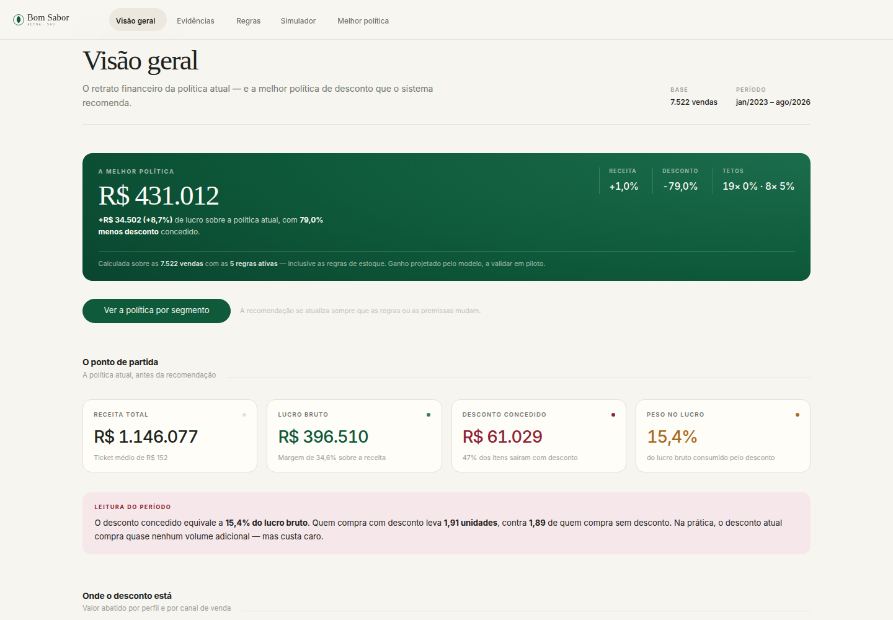
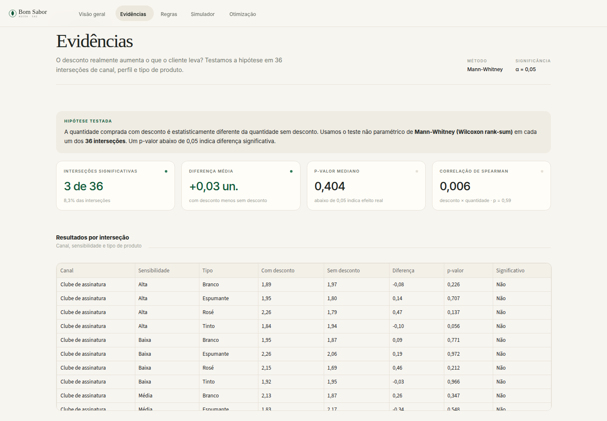
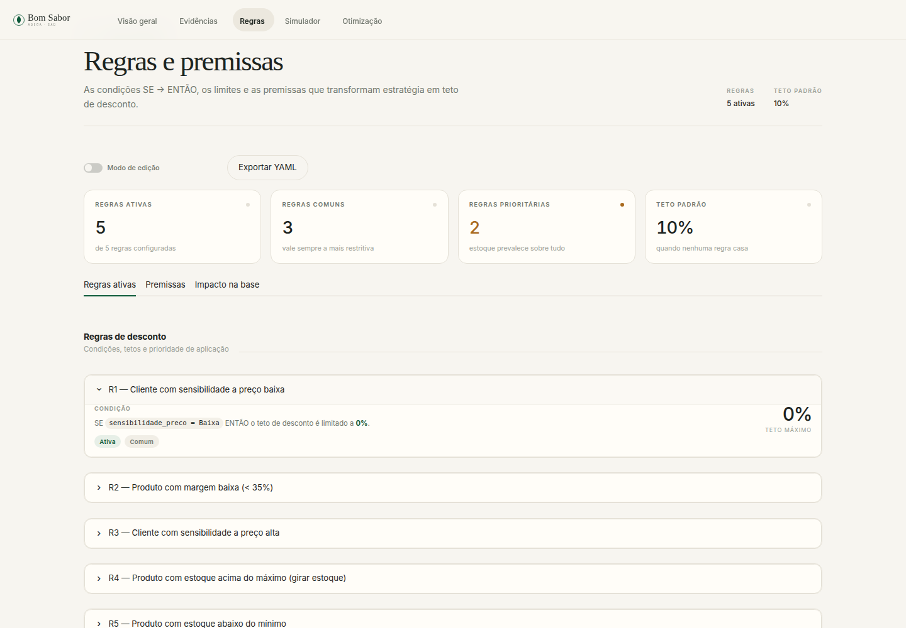
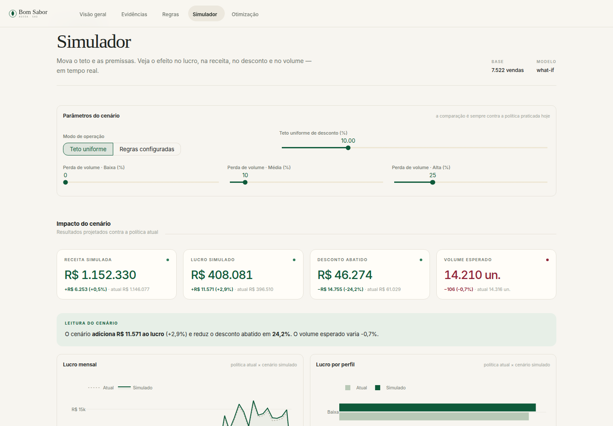
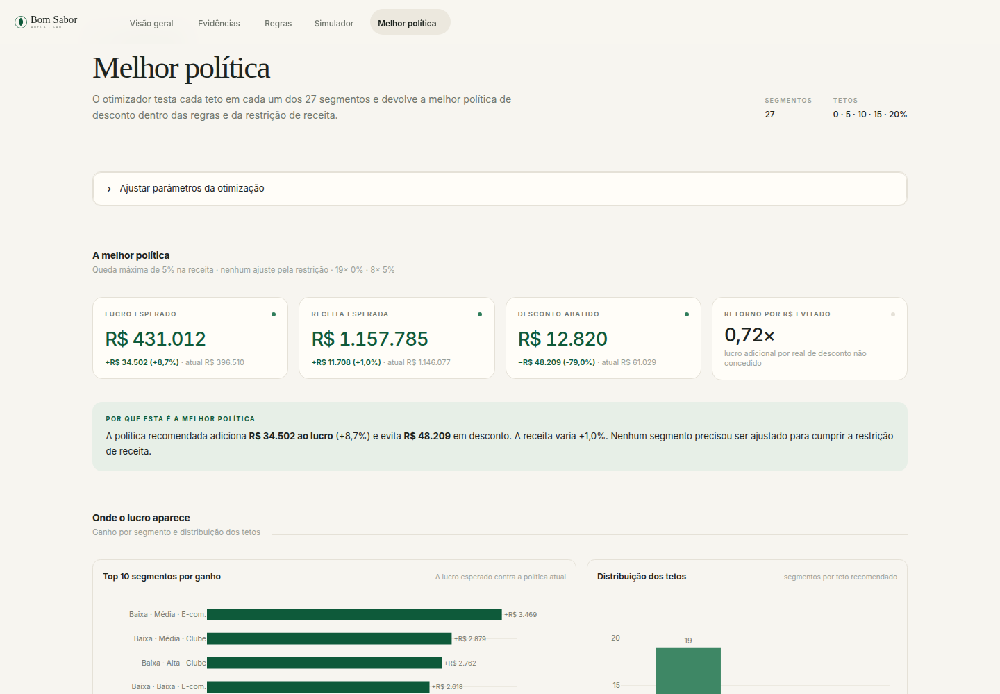

<div align="center">


# SAD de Política de Descontos

### Adega Bom Sabor · Sistema de Apoio à Decisão

*Do histórico de vendas a uma política de descontos que protege o lucro.*

[](https://python.org)
[](https://streamlit.io)
[](https://pandas.pydata.org)
[](https://plotly.com)
[](https://scipy.org)
[](#-testes)
[](#-licença)

**Projeto final de Sistemas de Apoio à Decisão · UEG / Trindade · 2026**

</div>

---

## 📑 Índice

- [📖 Sobre o Projeto](#-sobre-o-projeto)
- [🖼️ Interface](#️-interface)
- [✨ Funcionalidades](#-funcionalidades)
- [🏗️ Arquitetura](#️-arquitetura)
- [🧠 Modelo de Decisão](#-modelo-de-decisão)
- [📊 Resultados](#-resultados)
- [📂 Estrutura do Projeto](#-estrutura-do-projeto)
- [🧰 Stack Tecnológica](#-stack-tecnológica)
- [🚀 Começando](#-começando)
- [🧪 Testes](#-testes)
- [🧭 Fluxo de Uso](#-fluxo-de-uso)
- [⚙️ Decisões Técnicas](#️-decisões-técnicas)
- [⚠️ Limitações e Próximos Passos](#️-limitações-e-próximos-passos)
- [👥 Autores](#-autores)
- [📄 Licença](#-licença)

---

## 📖 Sobre o Projeto

O **SAD de Política de Descontos** é uma aplicação web local que ajuda o gerente comercial da **Adega Bom Sabor** a decidir **quanto desconto conceder para cada perfil de cliente, faixa de margem e canal de venda**.

A pergunta central nasce de um diagnóstico simples: o desconto atual consome **15,4% do lucro bruto** da operação, mas quem compra com desconto leva apenas **1,91 unidade** contra **1,89 unidade** de quem compra sem desconto. Ou seja, o desconto praticado quase não gera volume adicional — mas custa caro.

O sistema transforma esse diagnóstico em uma política acionável:

```text
ENTRADA                 PROCESSAMENTO                              RESULTADO
regras + premissas  →   inferência + simulação what-if +            melhor política por
+ restrição de          otimização com restrição de receita          segmento, impacto em
  receita                                                           lucro e receita,
                                                                    exportável em CSV e YAML
```

> 🎯 **O ponto do sistema é a melhor política.** Ela aparece já calculada na abertura da Visão geral e abre a página **Melhor política**: **+R$ 34.502 de lucro (+8,7%)**, **79% menos desconto concedido** e **19 dos 27 segmentos com teto 0%** — sempre respeitando as regras de negócio e a restrição de receita. O restante do sistema existe para sustentar essa resposta: diagnóstico, evidência, regras e simulação.

> 💡 **Diferencial**: as regras de negócio são **dados editáveis** (YAML), não código. O gestor altera tetos e premissas na interface, vê o impacto em tempo real e exporta a política recomendada para aplicação em produção.

---

## 🖼️ Interface

A interface foi desenhada para ser silenciosa e editorial: fundo em papel quente, cartões claros, hairlines, tipografia serifada nos títulos e apenas dois acentos de marca — **verde-garrafa** e **vinho**. Sem sidebar e sem ruído: a navegação fica no topo, o conteúdo ocupa a página inteira e uma única faixa verde-garrafa destaca **a melhor política** logo na entrada.

<table>
  <tr>
    <td width="50%"></td>
    <td width="50%"></td>
  </tr>
  <tr>
    <td width="50%"></td>
    <td width="50%"></td>
  </tr>
  <tr>
    <td colspan="2"></td>
  </tr>
</table>

### Design System

| Papel | Cor | Uso |
|---|---|---|
| Papel | `#F7F5F0` | Fundo da aplicação |
| Cartão | `#FFFDF8` | Superfícies e cartões |
| Tinta | `#1D241F` | Texto principal |
| Verde-garrafa | `#0E5A3A` | Ação, resultado positivo, série principal |
| Vinho | `#8F2437` | Alerta, desconto, resultado negativo |
| Ocre | `#A96A1E` | Atenção e séries intermediárias |
| Hairline | `#E5E1D7` | Divisores e bordas |

---

## ✨ Funcionalidades

### 📊 Visão geral
- **Faixa "A melhor política" na abertura**: lucro, ganho, desconto e distribuição dos tetos, com atalho para a política por segmento
- Indicadores do baseline: receita, lucro bruto, desconto abatido e peso no lucro
- Desconto por perfil de cliente e participação por canal
- Evolução mensal de lucro e desconto
- Leitura automática do período em linguagem de decisão

### 🔬 Evidências
- Teste de **Mann-Whitney** em **36 interseções** (canal × sensibilidade × tipo de produto)
- Correlação de **Spearman** entre desconto e quantidade
- Mapa de significância estatística e qualidade da base
- Tabela de evidências com valores localizados em pt-BR

### 🧩 Regras e premissas
- Base de regras **SE → ENTÃO** com condição, teto e prioridade
- **Modo de edição** com aplicação em sessão e restauração de padrão
- Edição de faixas de margem, teto padrão e perda de volume por perfil
- **Exportação YAML** da configuração vigente
- Impacto das regras sobre as vendas históricas

### 🎛️ Simulador
- Comparação entre a política atual e um cenário **what-if**
- Dois modos: **teto uniforme** ou **regras configuradas**
- Sensibilidade a teto de desconto e perda de volume por perfil
- Resultado imediato em lucro, receita, desconto e volume esperado
- Gráficos de lucro mensal e lucro por perfil

### 🎯 Melhor política
- A recomendação é calculada **na abertura da página**, sem depender de um clique
- Recalculada automaticamente quando regras, premissas ou faixas de margem mudam
- Testa cada teto (**0, 5, 10, 15 e 20%**) em cada um dos **27 segmentos**
- Escolhe a política de maior lucro dentro da restrição de queda de receita
- Aplica automaticamente as regras de estoque e prioridade
- Tabela completa por segmento com regra predominante e justificativas
- **Download em CSV** (por segmento) e **YAML** (regras + tetos)

---

## 🏗️ Arquitetura

O projeto separa a **engine de decisão** (`sad/`) da **camada de apresentação** (`pages/` + `ui.py`). A engine é composta por funções puras, testáveis e independentes do Streamlit.

```text
┌──────────────────────────────────────────────────────────────────────┐
│                         APRESENTAÇÃO (Streamlit)                     │
│  app.py · navegação superior · tema · rodapé                         │
│  pages/1_visao_geral.py … pages/5_recomendacao.py                    │
│  ui.py · design system, CSS, cache, formatação e componentes         │
└───────────────────────────────┬──────────────────────────────────────┘
                                │
┌───────────────────────────────▼──────────────────────────────────────┐
│                         ENGINE DE DECISÃO (sad/)                     │
│                                                                      │
│  data.py ──────► features.py ──────► diagnostico.py                  │
│  leitura e       integração,           indicadores e                 │
│  qualidade       segmentos             testes estatísticos           │
│       │                │                                             │
│       │                ▼                                             │
│       │          rules.py ──────► simulation.py ──────► optimizer.py │
│       │          regras SE→ENTÃO   what-if e             teto ótimo   │
│       │                            sensibilidade          por segmento│
│       └──────────► config/regras.yaml (regras + premissas)           │
└──────────────────────────────────────────────────────────────────────┘
```

### Camadas

| Camada | Responsabilidade |
|---|---|
| **Dados** | Leitura da planilha, integração das bases, colunas derivadas e relatório de qualidade |
| **Conhecimento** | Regras SE → ENTÃO, faixas de margem, premissas de perda de volume |
| **Simulação** | Modelo what-if, cenário de teto uniforme e análise de sensibilidade |
| **Otimização** | Busca do teto de maior lucro por segmento com restrição de receita |
| **Interface** | Navegação, design system, gráficos, edição de regras e exportações |

---

## 🧠 Modelo de Decisão

Para cada item vendido, o sistema recalcula desconto, quantidade esperada, receita e lucro:

```text
d_novo      = min(d_original, teto)
q_esperada  = q × (1 − ((d_original − d_novo) / d_original) × P_perfil / 100)
lucro       = (preço_tabela × (1 − d_novo) − custo) × q_esperada
```

Onde `P_perfil` é a perda de volume esperada ao remover completamente o desconto daquele perfil.

### Regras padrão

| ID | Condição | Teto | Tipo |
|---|---|---:|---|
| **R1** | Cliente com sensibilidade a preço **Baixa** | 0% | Comum |
| **R2** | Produto com margem **baixa** (< 35%) | 5% | Comum |
| **R3** | Cliente com sensibilidade a preço **Alta** | 15% | Comum |
| **R4** | Produto com estoque **acima do máximo** (girar estoque) | 20% | Prioritária |
| **R5** | Produto com estoque **abaixo do mínimo** | 0% | Prioritária |

- Entre as regras comuns, vale a **mais restritiva**.
- As regras de estoque (**R4** e **R5**) prevalecem sobre todas as demais.
- Quando nenhuma regra se aplica, vale o **teto padrão** de 10%.

### Premissas globais

| Premissa | Valor padrão |
|---|---:|
| Faixa de margem baixa | < 35% |
| Faixa de margem alta | > 42% |
| Teto padrão | 10% |
| Queda máxima de receita aceita | 5% |
| Perda de volume — Alta | 25% |
| Perda de volume — Média | 10% |
| Perda de volume — Baixa | 0% |

Todas as premissas e regras são editáveis na página **Regras e premissas** e persistidas em `config/regras.yaml`.

### Otimização

O otimizador percorre os **27 segmentos** e, para cada um, testa os tetos **0/5/10/15/20%**, escolhendo o de maior lucro esperado. Se a receita total cair além do limite definido pelo gestor, ele eleva o teto do segmento com maior perda de receita até cumprir a restrição — preservando a receita sem abrir mão do lucro onde ele é mais sensível.

---

## 📊 Resultados

### Baseline (jan/2023 – ago/2026)

| Indicador | Valor |
|---|---:|
| Vendas analisadas | **7.522** |
| Receita total | **R$ 1.146.077** |
| Lucro bruto | **R$ 396.510** |
| Desconto abatido | **R$ 61.029** |
| Peso do desconto no lucro | **15,4%** |
| Itens vendidos com desconto | **47%** |
| Quantidade média com desconto | **1,91 un.** |
| Quantidade média sem desconto | **1,89 un.** |

### A melhor política

| Indicador | Resultado |
|---|---:|
| Lucro esperado | **R$ 431.012** |
| Ganho de lucro | **+R$ 34.502 (+8,7%)** |
| Receita esperada | **R$ 1.157.785 (+1,0%)** |
| Desconto abatido | **R$ 12.820** |
| Desconto evitado | **−R$ 48.209 (−79,0%)** |
| Segmentos com teto 0% | **19 de 27** |
| Segmentos com teto 5% | **8 de 27** |
| Retorno por real de desconto evitado | **0,72×** |

> Os números são reproduzidos pelos testes automatizados e podem variar levemente se as regras ou premissas forem editadas.

---

## 📂 Estrutura do Projeto

```text
adega_sad/
├── app.py                        # shell: tema, navegação superior, rodapé
├── ui.py                         # design system, CSS, cache e componentes
├── pages/
│   ├── 1_visao_geral.py          # dashboard do baseline
│   ├── 2_evidencias.py           # testes estatísticos e qualidade da base
│   ├── 3_regras_premissas.py     # regras, edição, premissas e impacto
│   ├── 4_simulacao.py            # simulador what-if
│   └── 5_recomendacao.py         # melhor política, tabela e exports
├── sad/
│   ├── data.py                   # leitura da planilha e qualidade
│   ├── features.py               # integração, colunas derivadas e segmentos
│   ├── diagnostico.py            # indicadores, Mann-Whitney e Spearman
│   ├── rules.py                  # base de regras SE → ENTÃO e inferência
│   ├── simulation.py             # modelo what-if e sensibilidade
│   └── optimizer.py              # otimização por segmento com restrição
├── config/
│   └── regras.yaml               # regras e premissas padrão
├── data/
│   └── Base_Adega_Bom_Sabor_2026.xlsx
├── assets/
│   ├── marca.svg                 # wordmark do topo
│   └── favicon.svg               # ícone da aba
├── docs/
│   └── screenshots/              # capturas usadas neste README
├── tests/
│   └── test_baseline.py          # 13 testes contra os números do relatório
├── .streamlit/
│   └── config.toml               # tema claro, cores, raio e tipografia
├── requirements.txt
└── README.md
```

---

## 🧰 Stack Tecnológica

| Categoria | Tecnologia | Papel |
|---|---|---|
| **Linguagem** | Python 3.11+ | Engine e aplicação |
| **Interface** | Streamlit 1.67+ | Navegação, formulários, tabelas e estado |
| **Dados** | Pandas 2.x + OpenPyXL | Integração e leitura da planilha |
| **Visualização** | Plotly 5.x | Gráficos com a paleta da marca |
| **Estatística** | SciPy 1.11+ | Mann-Whitney, Spearman e testes |
| **Configuração** | PyYAML 6.x | Regras e premissas editáveis |
| **Qualidade** | Pytest 8.x | Testes de regressão numérica |

---

## 🚀 Começando

### Pré-requisitos

- **Python 3.11 ou superior**
- Git (opcional, para clonar o repositório)

### 1. Clone o repositório

```bash
git clone https://github.com/DevFalconszz/adega-sad.git
cd adega-sad
```

### 2. Crie o ambiente virtual

```bash
python -m venv .venv
source .venv/bin/activate        # Linux / macOS
# .venv\Scripts\activate         # Windows
```

### 3. Instale as dependências

```bash
pip install -r requirements.txt
```

### 4. Execute a aplicação

```bash
streamlit run app.py
```

O navegador abre automaticamente em **http://localhost:8501**. A planilha `data/Base_Adega_Bom_Sabor_2026.xlsx` já está incluída no projeto — não é necessário configurar banco de dados.

<details>
<summary><strong>Rodar em segundo plano (Linux)</strong></summary>

```bash
setsid nohup .venv/bin/streamlit run app.py \
  --server.headless true --server.port 8501 \
  > streamlit.log 2>&1 < /dev/null &
```

Verifique a saúde do servidor em `http://localhost:8501/_stcore/health`.

</details>

---

## 🧪 Testes

Os testes conferem os números do relatório técnico e protegem a engine contra regressões:

```bash
python -m pytest tests -q
```

```text
.............                                            [100%]
13 passed
```

Cobertura atual:

- Volumes e qualidade das bases (nulos, duplicidade e consistência de preço)
- Indicadores do baseline (receita, lucro, desconto abatido e volume médio)
- Segmentação em 27 combinações (sensibilidade × margem × canal)
- Inferência das regras R1–R5 e prioridade das regras de estoque
- Simulação das regras padrão e cenários what-if
- Otimização por segmento e acionamento da restrição de receita
- Distribuição do ganho por perfil e breakeven da política
- Correlação de Spearman e teste de Welch por perfil

---

## 🧭 Fluxo de Uso

| Passo | Página | O que fazer |
|---:|---|---|
| **1** | **Visão geral** | Comece pela faixa **A melhor política**: o resultado do sistema já aparece aqui. Abaixo, entenda o tamanho do problema. |
| **2** | **Evidências** | Confira se o desconto aumenta volume de forma estatisticamente significativa. |
| **3** | **Regras e premissas** | Ajuste tetos, faixas de margem e perda de volume. Ative o **Modo de edição**, aplique e exporte o YAML. |
| **4** | **Simulador** | Teste cenários de teto uniforme ou as regras configuradas, em tempo real. |
| **5** | **Melhor política** | A política já vem calculada. Recalcule após mover parâmetros e baixe em CSV (por segmento) ou YAML (regras + tetos). |

As alterações de regras e premissas valem para toda a aplicação durante a sessão. O resultado da otimização é recalculado automaticamente quando a configuração muda.

---

## ⚙️ Decisões Técnicas

- **Regras como dados.** A política vive em `config/regras.yaml`, não no código. Isso permite edição pelo gestor, versionamento e exportação sem alterar a aplicação.
- **Engine pura e testável.** `sad/` não importa Streamlit. Toda a lógica de decisão pode ser executada em scripts, notebooks ou testes.
- **Cache em camadas.** Leitura da planilha, dataset integrado e simulações usam `st.cache_data`, mantendo a interface responsiva.
- **Testes contra o relatório.** Os 13 testes travam os números do baseline e da otimização, evitando que uma mudança de UI altere o resultado sem aviso.
- **Localização independente do sistema.** Meses, eixos e decimais são formatados em pt-BR sem depender do locale do processo.
- **Interface sem sidebar.** Navegação superior nativa (`st.navigation`), tema claro e componentes próprios para reduzir ruído visual.
- **Exportações auditáveis.** CSV por segmento e YAML com regras, premissas e tetos recomendados.

---

## ⚠️ Limitações e Próximos Passos

- A base é **acadêmica e histórica** (jan/2023 – ago/2026). Agosto de 2026 é um mês parcial (15 dias) e aparece abaixo dos meses completos nos gráficos.
- O modelo de elasticidade usa **premissas de perda de volume por perfil**, não elasticidade-preço estimada causalmente.
- O otimizador é **guloso por segmento**, não uma otimização global inteira. Um próximo passo é formular o problema como programação linear inteira.
- A aplicação é **local e sem autenticação**. Para uso multiusuário seria necessário persistir configurações e resultados em banco de dados.
- Próximos passos: integração com ERP, acompanhamento em produção (teste A/B), explicabilidade por segmento e alertas de desvio de política.

---

## 👥 Autores

<table>
  <tr>
    <td align="center"><strong>Lisia Maria Becker Tabalipa</strong></td>
    <td align="center"><strong>Ítallo Rhide Furuya Ferreira</strong></td>
    <td align="center"><strong>Patrick Oliveira Vagetti</strong></td>
  </tr>
</table>

**Universidade Estadual de Goiás — UEG · Unidade Universitária de Trindade**
Projeto final da disciplina de Sistemas de Apoio à Decisão · 2026

---

## 📄 Licença

Distribuído sob a licença **MIT**. Consulte [`LICENSE`](LICENSE) para mais informações.

<div align="center">

---

*Feito para decidir com dados — e não com desconto no escuro.*

</div>
